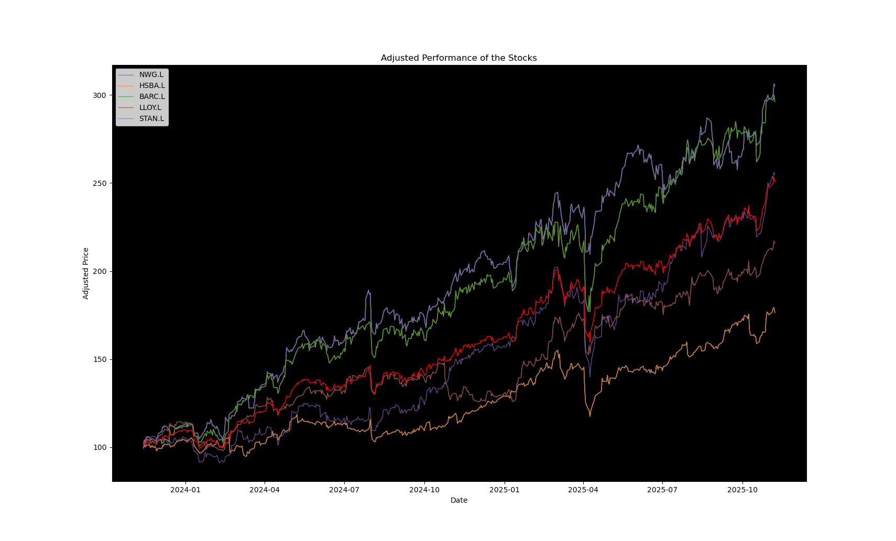
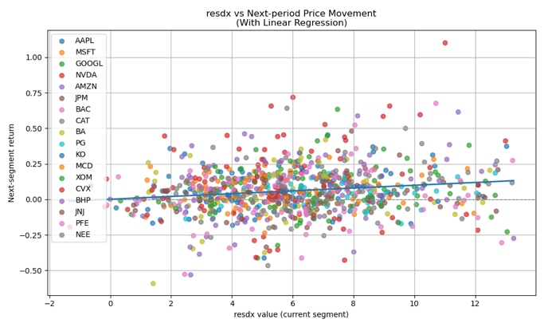

# Equity Portfolio Risk Modelling & Optimisation

Python behind my second-year University of Bath portfolio project
(coursework December 2025 – February 2026, graded First, 71%; tracked out of
sample to November 2026): a systematic UK equity
portfolio built with a Monte Carlo weight optimiser, sector and drawdown
analytics, and an 18-year test of whether rising market-wide correlation
predicts downturns. Daily data from Yahoo Finance via `yfinance`; NumPy,
pandas, statsmodels, matplotlib.

## Files

| file | what it does |
|------|--------------|
| `sector_resilience.py` | normalised performance, max drawdown and performance-adjusted MDD for same-sector baskets (e.g. the five UK banks vs their sector mean) |
| `correlation_matrix.py` | Pearson correlation heatmap of the candidate universe |
| `correlation_regime_study.py` | aggregate cross-asset correlation per asset and window, drawn as a surface over 2007–2025, then regressed against next-window performance |
| `sharpe_screen.py` | per-stock Sharpe screen of the candidate universe |
| `monte_carlo_weight_optimisation.py` | GBM Monte Carlo over random weight vectors (1,000 portfolios × 200 paths), scored by mean Sharpe, adjusted Sharpe and dispersion of outcomes |
| `gradient_descent_weights.py` | exploratory gradient-ascent alternative over the feasible weight region |
| `out_of_sample_tracking.py` | plots the handed-in weights after the submission date |
| `out_of_sample_comparison.py` | in-sample and out-of-sample Sharpe, volatility, drawdown and CVaR of the Monte Carlo, handed-in and equal-weight portfolios against the FTSE 100; the source of the out-of-sample figures below |

## Figures



*`sector_resilience.py`: NatWest, Barclays, Lloyds, HSBC and Standard Chartered
rebased to 100, sector mean in red.*


*`correlation_regime_study.py`: each asset's summed correlation with the rest
of the basket, per ~90-day window; the ridges are the windows where the whole
basket moved together.*



*The regression behind the null result: the fitted slope is positive, not the
negative one the hypothesis predicted.*

## Results

* **Weight optimisation.** Adjusted Sharpe (mean Sharpe across a portfolio's
  simulated paths divided by its standard deviation) was the metric chosen for
  the final weights, reflecting a preference for stable expected returns over
  the two-month horizon of the exercise.
* **Out of sample.** Tracked for eleven months after submission (5 December
  2025 to 13 November 2026; portfolio rebalanced daily to the Monte Carlo
  weights, gross of costs; FTSE 100 price index as benchmark): 14% total
  return against 12% for the index, Sharpe 0.78 against 0.75, which is not a
  significant difference over this horizon, and no edge over an equal-weight
  basket of the same stocks (14%, Sharpe 0.82). The eight-month figures shown
  here until November 2026 (Sharpe 1.6 against 0.9, 53% smaller drawdown) did
  not survive the longer window and were computed with the wrong ticker for
  BAE Systems (see Notes). `out_of_sample_comparison.py` produces these figures.
* **Correlation as a downturn predictor — null.** Across three definitions of
  next-window performance and two basket versions (with and without the gold and
  Treasury hedges), the hypothesised negative slope never appeared: the two
  significant fits (raw comparison, p < 0.001) were positive, the other four not
  significant. The likely reason is documented in the report: correlations rise
  *into* a top, so most high-correlation windows are still followed by gains.

## Running things

```
pip install -r requirements.txt
python monte_carlo_weight_optimisation.py
```

Each script downloads what it needs from Yahoo Finance at run time (an
internet connection is required; `yfinance` occasionally changes its column
layout, which `fetch_close_prices` handles). Tickers, date ranges and simulation
sizes are constants at the top of each file.

## Notes

Coursework code, cleaned up for publication: names, imports and one unfinished
loop were fixed, the methods are untouched. Correction, November 2026: the original scripts used Yahoo's symbol
BAES.L for BAE Systems. On Yahoo Finance that symbol is the Leverage Shares
-1x Short Boeing ETP (quoted in euros); BAE Systems plc is BA.L. All scripts
now use BA.L. The in-sample optimisation and the out-of-sample figures
published here before November 2026 included that instrument in the BAE
Systems slot; the Results section above is computed with BA.L. Re-running the
scripts today will download a different window of data.
